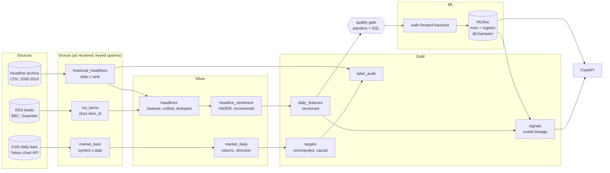

# Architecture

## Orchestration (Airflow)

| DAG | Schedule | Tasks |
|---|---|---|
| `news_backfill` | manual | `ingest_historical` ‖ `ingest_market` → `build_warehouse` → `build_features` → `quality_gate` |
| `news_daily` | 22:00 UTC, Mon–Fri | `ingest_rss` ‖ `ingest_market` → `build_warehouse` → `build_features` → `quality_gate` → `score` |
| `model_retrain` | Fri 23:00 UTC | `ExternalTaskSensor(news_daily.quality_gate)` → `backtest_and_register` → `rescore` |

DAG files only orchestrate. Every task calls a function in `newspipe.tasks`, which is
idempotent, tracked in `ops.pipeline_runs` (the Airflow run id is the lineage key) and
tested without a scheduler. Tasks retry with exponential backoff.

## Incrementality and idempotency

| Stage | Mechanism |
|---|---|
| Archive ingest | Checksum-pinned download; `INSERT OR REPLACE` on (date, rank) |
| Market ingest | Watermark = last stored date; refetch a 5-day overlap so revised bars replace old ones; upsert on (symbol, date) |
| RSS ingest | `item_id = sha1(feed, guid)`; `ON CONFLICT DO NOTHING`; per-feed publish watermark; one failing feed never blocks the others |
| Sentiment | Only headline hashes never scored before are sent to VADER |
| Scoring | Only days not yet scored by the *current champion version* |

## Model lifecycle

1. `run_backtest` evaluates all candidates walk-forward and logs a parent run with nested
   runs per model, fold metrics by year, and CSV artifacts to MLflow.
2. The best *servable* model (by pooled balanced accuracy) is refit on all history, logged
   with an input signature and example, and registered as a new version of
   `news-direction-classifier`.
3. Champion/challenger: the `champion` alias moves only if the new version beats the
   current champion on the same target.
4. `score_new_days` and the API always load `models:/news-direction-classifier@champion`,
   and `gold.signals` stores the version used for every prediction.
